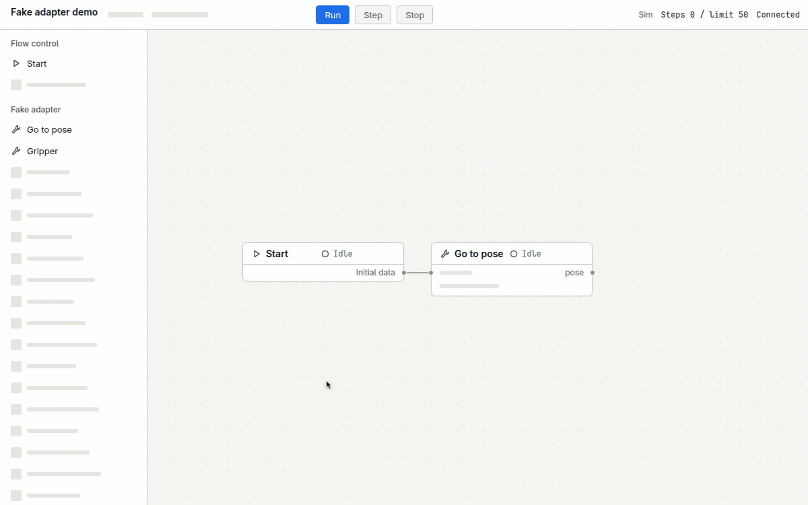

# Roboact

<picture>
  <source media="(prefers-color-scheme: dark)" srcset="demo/hero/media/hero-dark.gif">
  
</picture>

[Fake adapter demo (MP4)](demo/hero/media/hero.mp4)

Offline robot flow canvas. Wire adapter actions into a loopable flow; debug with breakpoints, step, human confirm, and a run log. v1 ships `FakeAdapter` only (`target=sim`). MIT (`LICENSE`).

- Python 3.12 asyncio backend. Frontend is Vue 3 + Vue Flow 1.48.2, **zero build** (native ES modules). Bind is `127.0.0.1` only — no `--host`, no auth.
- Offline: fonts, icons, and JS live in the repo. Latin UI uses Inter; mono uses JetBrains Mono (`roboact/static/fonts/`, OFL). CJK uses the system font.

## Run

```bash
uv sync --frozen
uv run python -m roboact          # http://127.0.0.1:7465
# other machine: ssh -L 17465:127.0.0.1:17465 <controller>
```

`Host` must be `127.0.0.1` / `localhost` / `[::1]`. SSE/WebSocket `Origin` must be this page. Commands need `Content-Type: application/json`.

## Offline install

Wheels live in `vendor/wheels` (including `ruamel.yaml`, required for YAML import). No network:

```bash
python3 -m venv .venv
.venv/bin/pip install --no-index --find-links vendor/wheels -r requirements.txt
.venv/bin/python -c "import ruamel.yaml"
.venv/bin/python -m roboact
```

## Connection drop

- Page gone ~10 s → cancel the current action if cancellable, then pause `operator_lost`. A non-cancellable or refused cancel runs to end, then pause.
- Adapter silent ~3 s → pause `adapter_lost`. Continue stays off until the adapter is back.
- Stop is hold-position, motors on. Not e-stop. No e-stop on the canvas.
- After a crash, the run stays paused. In-flight `motion` is `interrupted_unknown`; read back, then redo or mark done.

## Limits

Step limit 1000. Node timeout 60 s (deadline given to the adapter). SSE retry 2 s. SQLite `busy_timeout` 5000 ms. Browser stores only display prefs (`roboact.lang|theme|motion|viewport.*|panels|grid|minimap|logFilter`). Timeouts stay on the server.

Storage, HTTP, SSE, and exported flows carry **codes**. UI maps codes via `web/i18n/en.js` and `web/i18n/zh-CN.js`.

```bash
scripts/check.sh    # uv lock, ruff, pyright, pytest, private-IP, gitleaks
```

Product spec: [docs/prd.md](docs/prd.md). How a run works: [docs/exec-model.md](docs/exec-model.md).
