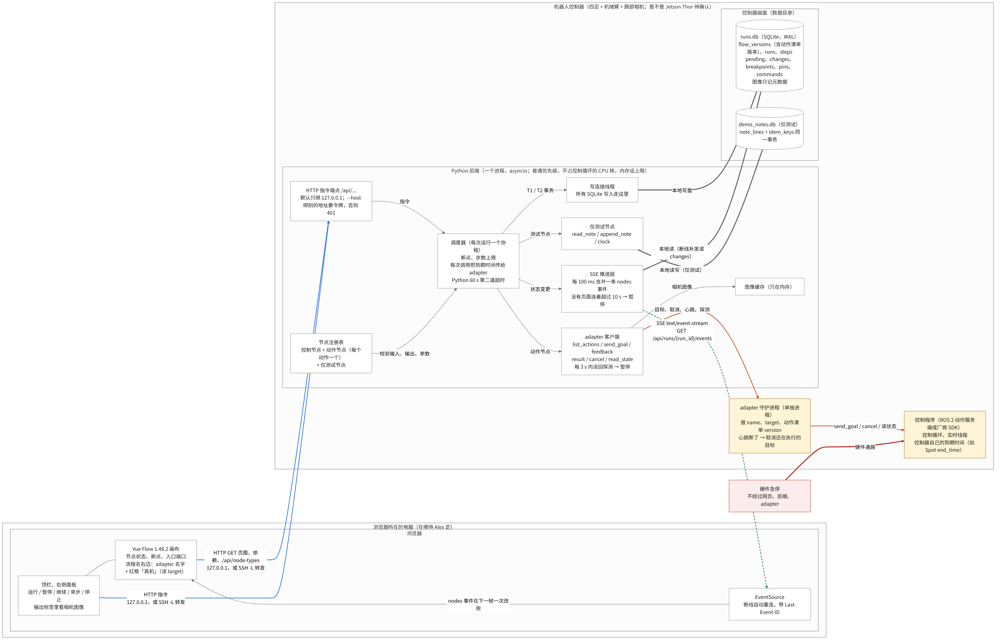
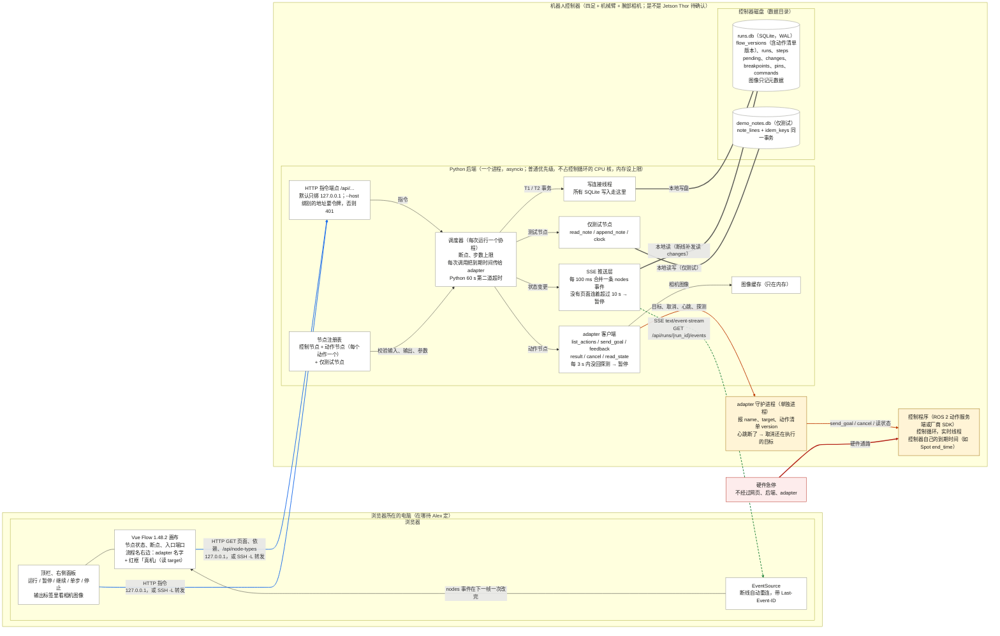
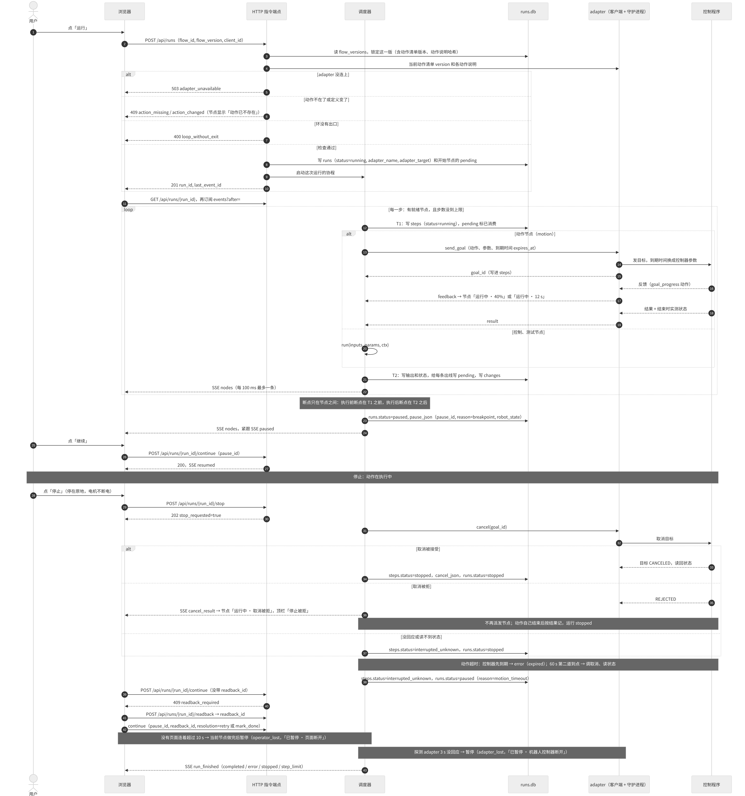
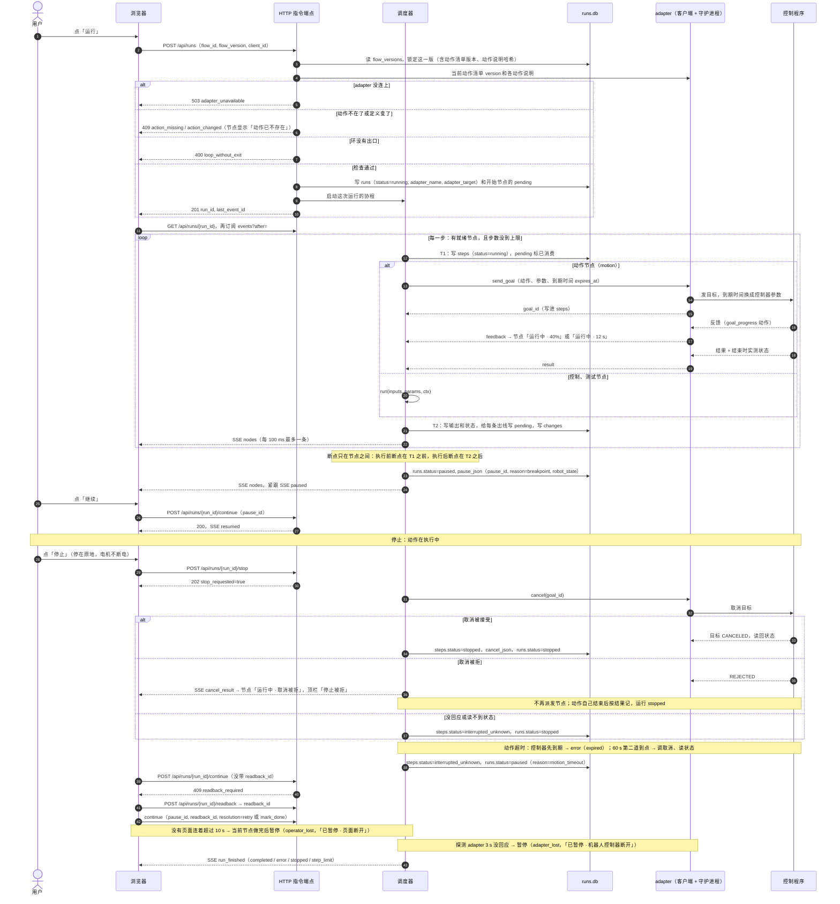
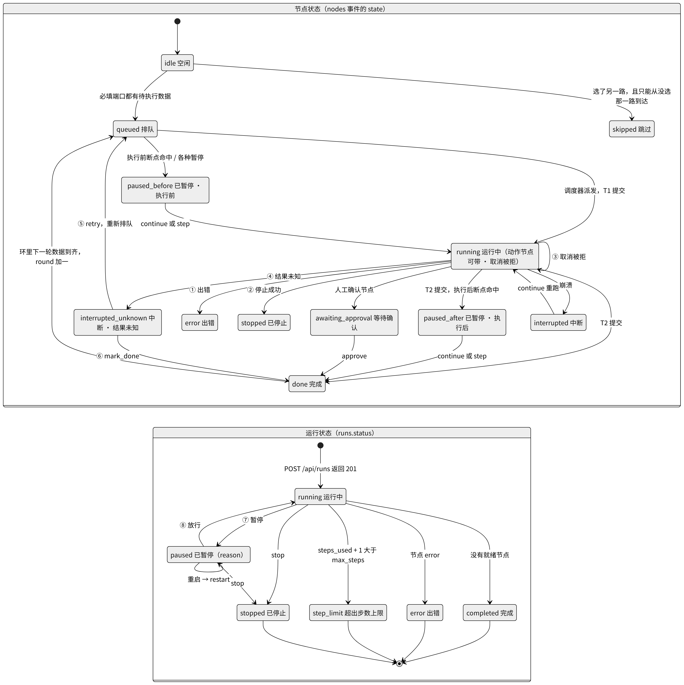
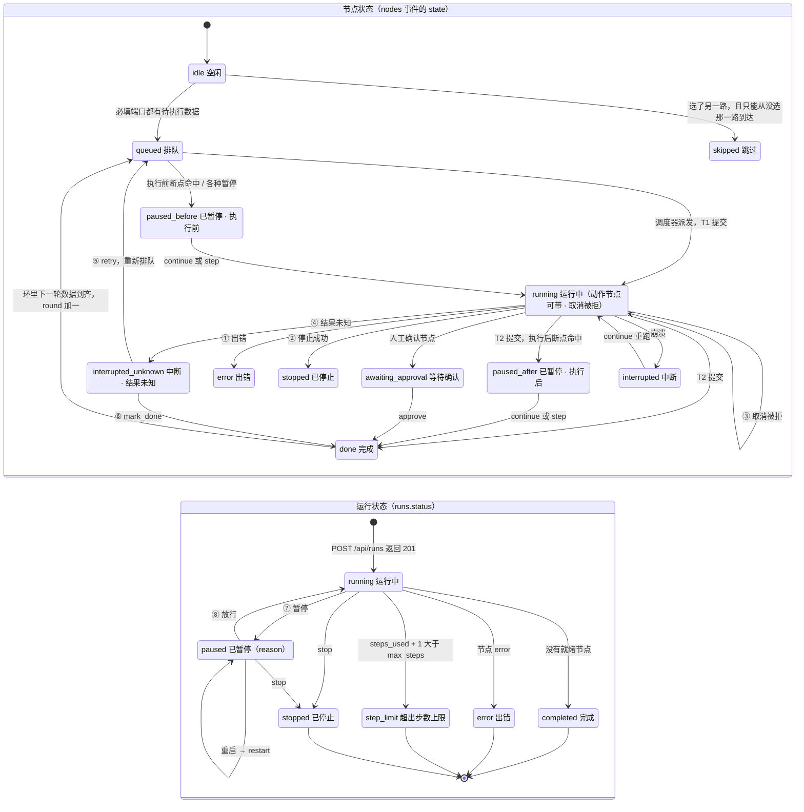
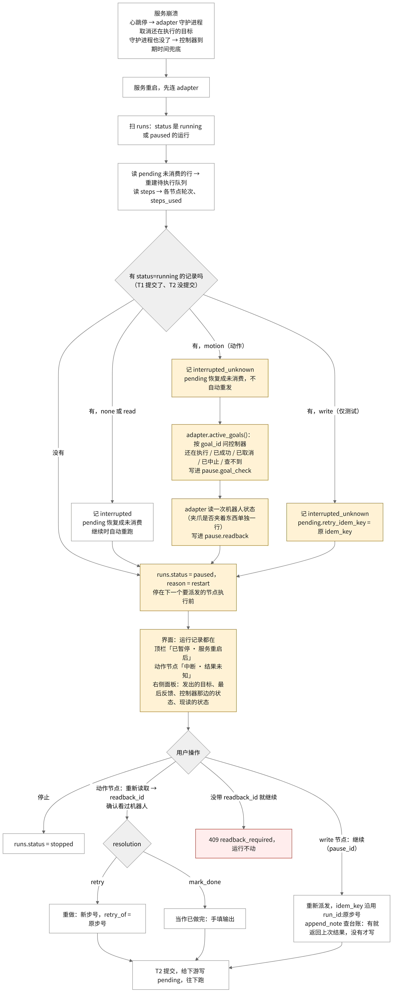
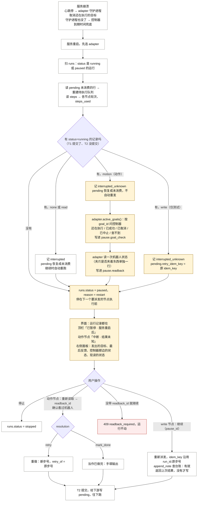

# 系统设计图 v0：Agent 流程画布

日期：2026-10-31（v0.2：跟随 exec-model v0.2 改了图 1–4，后端搬到机器人控制器上，加 adapter、动作节点、取消、到期和心跳）　依据：执行模型规格 `exec-model-v0.md` v0.2（以它为准）、PRD v1.4 定稿、界面规格 v0（含第 16 节，2026-10-31 17:05 读取）、Torvalds 17:14 已实现的默认值
图的源码就是下面的 mermaid 代码块；PNG 在 `/workspace/agent-ui/diagrams/`，由 mermaid-cli（`mmdc`）从同一份代码渲染。
所有状态名、端点名、事件名照抄 `exec-model-v0.md`。和界面规格、PRD 命名不同的地方列在文末。

图里的线分四种：

| 线型 | 含义 |
|---|---|
| 蓝色实线，标「HTTP」 | 浏览器发出的普通 HTTP 请求：取页面和依赖文件，或者发指令 |
| 绿色虚线，标「SSE」 | 服务端往浏览器推的事件流。SSE（Server-Sent Events）是一条不关闭的 HTTP 响应，服务端在里面一条一条写事件，浏览器用自带的 `EventSource` 接 |
| 灰色粗线，标「本地写盘」或「本地读」 | 后端进程读写控制器上的文件 |
| 橙色实线 | 后端和 adapter、adapter 和控制程序之间：发目标、收反馈、取消、心跳 |

---

## 图 1：部署和组件

这张图回答：系统由哪些部分组成，各放在哪里，彼此之间走什么协议，哪里会断。

后端、adapter、控制程序都在机器人控制器上（PRD 第 7 节）。adapter 分两半：后端进程里的客户端，和单独进程的守护进程；后端死了，守护进程收不到心跳，就取消还在执行的目标（`exec-model-v0.md` 第 2.5、2.5.4 节）。急停走硬件，不经过这张图里的任何软件。





要点：
- 哪里会断：后端死了，ROS 2 动作服务端发现不了（[rclcpp#2241](https://github.com/ros2/rclcpp/issues/2241)），所以靠守护进程的心跳取消目标；守护进程也死了，靠控制器自己的到期时间；控制器不接受到期时间的动作（「到期只靠 adapter」），后端卡住时这一步停不下来，界面在参数表单底部写明（界面规格 16.y）。
- 10 s、3 s、60 s 是 Torvalds 已实现的默认值，没有出处，可配置。
- 浏览器默认在控制器本机打开；在另一台电脑上时，用 SSH 端口转发，或者 `--host` 绑局域网地址加令牌。待 Alex 定（`exec-model-v0.md` 第 0.2 节）。
- 图像只在内存里，`runs.db` 里只有尺寸、拍摄时间、第几轮、第几步。`demo_notes.db` 只给测试节点用。

---

## 图 2：一次运行的时序

这张图回答：从点「运行」到运行结束，浏览器、后端、adapter、控制程序之间按什么顺序发生什么；停止、动作超时和断开时怎么走。





要点：
- 暂停和断点不取消正在执行的动作，等它做完才停（`exec-model-v0.md` 第 2.6、3 节）。先返回的动作（`goal_progress`）也要等结果回来才算做完。
- 结果未知的动作永不自动重试：继续前必须有一次读回，再由人选「重做」（新步号，`retry_of` 指向原步）或「当作已做完」（手填输出）。
- 测试用 `write` 节点超时照 v0.1：记 `interrupted_unknown`，运行 `paused`（`reason=write_timeout`），继续时带原幂等键重试。

---

## 图 3：节点状态和运行状态

这张图回答：一个节点、一次运行各有哪些状态，从一个状态到另一个状态靠什么触发。节点状态是 SSE `nodes` 事件里的 `state`；运行状态是 `runs.status`，暂停时另有暂停原因 `reason`。





图里带圈的编号：

| 编号 | 触发 |
|---|---|
| ① 出错 | 抛异常；`none`、`read` 节点超时；动作被控制器拒绝、中止、到期；前提条件不满足；输出不能序列化 |
| ② 停止成功 | 点停止：`none`、`read` 节点取消任务；动作节点取消被接受并读回 |
| ③ 取消被拒 | 点停止，控制器拒绝取消：节点保持运行中，等动作自己结束 |
| ④ 结果未知 | 动作：60 s 第二道超时、adapter 断开、服务崩溃、取消没回应；测试 `write` 节点：超时或崩溃 |
| ⑤ retry | 动作：读回后人选重做，重新排队，新步号；`write`：继续时重新派发，沿用原幂等键 |
| ⑥ mark_done | 动作：读回后人选当作已做完，手填输出 |
| ⑦ 暂停 | `reason` 取 breakpoint / user / step_done / approval / storage_error / write_timeout / motion_timeout / adapter_lost（探测 3 s 没回应）/ operator_lost（没有页面连着 10 s） |
| 崩溃 → interrupted | `none`、`read` 节点执行中服务崩溃；continue 时用新步号重跑 |
| ⑧ 放行 | continue、step 或 approve（approval 时只认 approve）；结果未知时要 `readback_id` 和 `resolution` |

要点：
- 「取消被拒」不是单独的状态：节点仍是 `running`，带 `cancel.cancel_response = rejected`；运行仍是 `running`，带 `stop_requested = true`，界面据此写「停止被拒」。
- 「动作已不存在」也不在状态机里，它是开跑前的检查结果，运行根本不会开始。
- `continue`、`step`、`approve` 都要带当前的 `pause_id`，不一致返回 409 `pause_mismatch`；停在人工确认上时 `continue`、`step` 返回 409 `awaiting_approval`；结果未知时没带读回返回 409 `readback_required`。这几条自环图里没画。
- 动作节点的输出不能在执行后断点上改（422 `motion_output_readonly`）。

---

## 图 4：服务重启恢复

这张图回答：动作或测试写节点执行到一半服务崩溃，重启后系统怎么判断，界面显示什么，为什么不会自动再做一遍。

记录在 SQLite 里，重启后都在。执行器只知道某一步 T1 提交了、T2 没提交。动作节点：先问控制器这个目标现在怎样（动作服务端缓存结果，状态话题是 TRANSIENT_LOCAL，见 [ROS 2 Actions 设计文档](https://design.ros2.org/articles/actions.html)），再读一次机器人状态，然后停住等人。测试写节点：照 v0.1，继续时带原幂等键重试。





要点：
- 普通的继续和单步在这里不可用，因为它们会原样重发同一个动作；只有读回之后人选「重做」或「当作已做完」（`exec-model-v0.md` 第 2.6、8 节，验收 A29）。
- 控制器那边查到目标「还在执行」，说明心跳这一层没起作用，界面要明说。
- adapter 连不上时，恢复照做，`goal_check` 和 `readback` 写「adapter 未连上」，继续和单步置灰。
- 测试写节点这条路和 v0.1 一样（验收 A1、A18、A20）。

---

## 渲染方法

```
cd /workspace/agent-ui/diagrams
mmdc -i 1-deployment.mmd -o 1-deployment.png -c mermaid-config.json -p puppeteer-config.json -w 2000 -s 2 -b white
```

四张图同样渲染，竖长的图用 `-s 3` 让宽度过 1600px。`puppeteer-config.json` 指向本机的 `/usr/bin/google-chrome`。`mermaid-config.json` 把字体设为 `Noto Sans CJK SC`（本机已装），中文不会变成方块。`.mmd` 文件是从本文件的代码块原样抽出来的。

---

## 和 exec-model、PRD、界面规格对不上的地方

图里一律用 `exec-model-v0.md` v0.2 的名字。PRD 和界面规格我都没改。完整清单在 `exec-model-v0.md` 文末，这里只列和图直接相关的：

1. 界面规格第 1 节状态词还没有「页面断开」「机器人控制器断开」和动作超时的词；图 2、图 3 用的是 Torvalds 已实现的「已暂停 · 页面断开」「已暂停 · 机器人控制器断开」。
2. 界面规格第 3.1 节说 `interrupted_unknown` 只出现在 `write` 节点，`interrupted` 继续时自动重跑。图 3、图 4 里动作节点被打断记 `interrupted_unknown`，要读回加人确认。
3. PRD 第 3 节第 14 步说关掉页面运行照常继续；现在没有页面连着超过 10 s 会暂停。
4. 界面规格第 16 节「停止被拒」在运行状态里没有对应值，图 3 里是 `running` 加 `stop_requested`。
5. 界面规格第 1 节的「暂停中…」仍是浏览器自己的显示状态，没画进运行状态机（和 v0.1 一样）。
